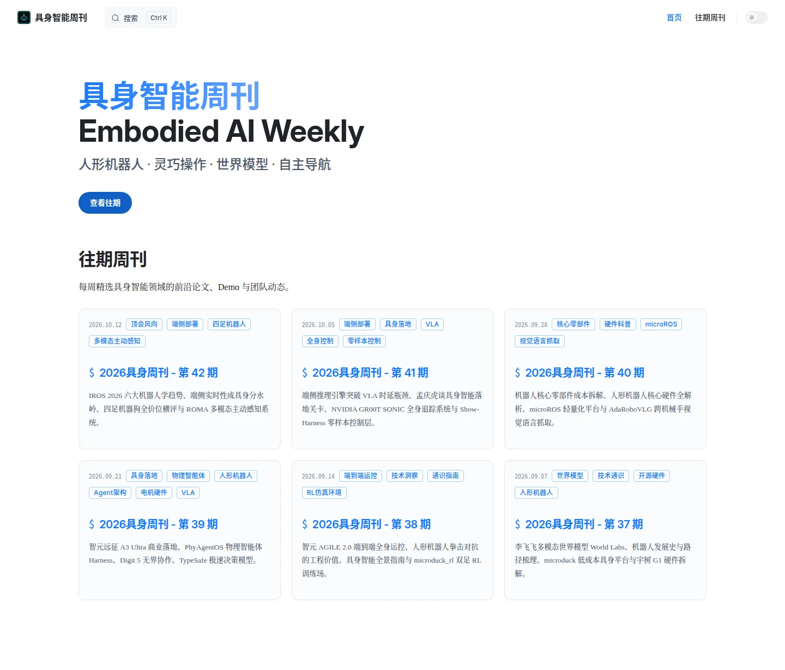
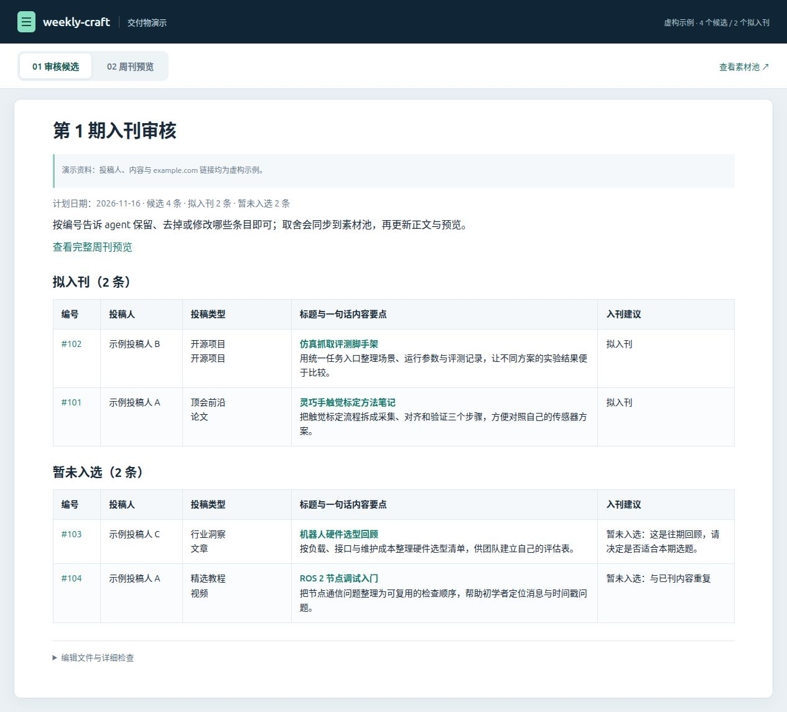
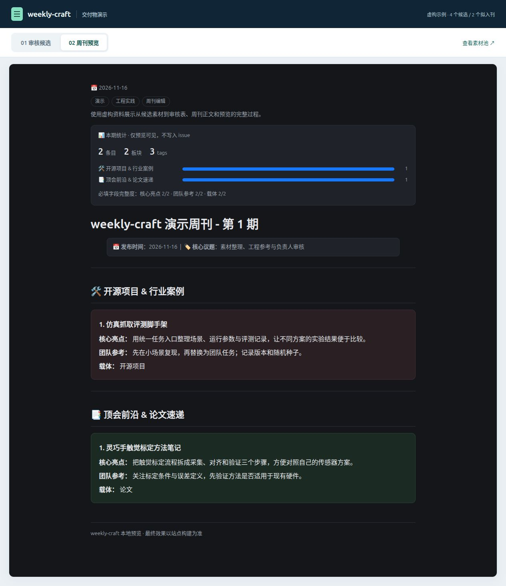

一期具身智能周刊发布出来，读者看到的是几组标题、摘要和链接。但在它变成网页之前，还要完成一串不太显眼的工作：收集投稿、检查重复、核对来源、归类、改摘要、统一格式，再更新网站入口。

每一步都不算特别难。麻烦在于，下周还要再来一遍。

维护[《具身智能周刊》](https://kingdream-cn.github.io/embodied-ai-weekly/)的过程中，我逐步搭起了一套流程：GitHub 提供投稿入口，自动化程序校验并维护私有台账，weekly-craft skill 辅助整理内容，最后生成供我审核的正文、预览和网站变更。

目前，这条流程交付的是可审核的出刊包。选哪些内容、何时发布，仍由我和负责人决定。第 47 期已经做过真实候选演练，但还有来源待核对，尚未正式发布。

这篇文章就沿着一条投稿的路径，记录这套流程怎样搭起来，以及做完之后，我对脚本、AI 和人的分工有哪些认识。

<!-- more -->



*这是[公开仓库 README 中的首页截图](https://github.com/kingdream-cn/embodied-ai-weekly/blob/dd9c430b30201816fb5a7f099c3a323a5a2f195f/screenshots/home.png)，用于说明站点布局。图中期次是截图当时的内容，不代表当前最新期号。*

## 编周刊，不只是让 AI 写摘要

如果只看最终页面，很容易把编刊理解成“找几篇文章，让 AI 总结一下”。我拆过一遍才发现，这里面混着几种性质不同的工作。

收集投稿，要查字段、来源和周期；维护运营记录，要处理修改、撤回和有效投稿统计；编辑内容，要读原文、判断价值、改摘要；出刊时，还要检查格式、更新网站入口。

字段解析可以交给稳定规则，摘要需要理解上下文，选题则要结合周刊定位。我不想用同一种工具包办这些事，便先把链路拆开：

```text
成员通过 GitHub Issue Form 投稿
                ↓
字段、身份、周期与重复校验
                ↓
私有投稿台账
                ↓
weekly-craft 读取候选与已刊历史
                ↓
编辑素材池：归类、摘要、原文核对
                ↓
负责人审核与取舍
                ↓
生成正文、预览和网站更新补丁
                ↓
按明确指令进入提交、发布流程
```

拆开以后，每个环节的输入和输出都更清楚，也更容易判断问题出在哪一层。

### 点一步，看看谁在处理什么

我把上面的链路做成了一个可点击的演示。选择流程节点，可以看到输入、输出和负责者；切换到审核表与正文预览，能看到公开示例的具体产物。

<iframe src="/demos/weekly-craft/" title="weekly-craft 编刊流程与虚构数据交互演示" width="100%" height="880" loading="lazy" sandbox="allow-scripts" style="border:1px solid #64748b55;border-radius:12px;display:block;"></iframe>

[在独立页面打开演示](/demos/weekly-craft/)。流程节点是讲解示意，不会执行发布；审核表使用仓库提供的虚构数据，正文预览由我本次运行公开脚本生成。这个演示与真实第 47 期的审核状态无关。

## GitHub 收投稿，私有台账记运营

### 投稿有了固定入口，也仍然需要校验

公开仓库承担两个职责：接收投稿，以及保存已刊内容和网站。

投稿使用 Issue Form，按照约定填写来源、内容和推荐理由。一篇来源对应一条投稿，需要修订时修改原 Issue。这样，链接和讨论有共同的落点，后续程序也有统一的读取入口。

但表单只是入口。Issue 正文仍然可以被编辑，必填提示也无法证明链接有效，更无法判断它是否已经刊登过。因此，后台还要解析字段、校验身份、判断周期，并检查来源重复。

这里的重复检查也有边界：URL 规范化能帮助识别同源链接，却不能直接判断两篇不同网址的文章是否讲了同一件事。后者仍需要编辑判断。

### 公开内容和内部运营分开保存

周刊正文适合公开，成员身份映射、完成统计、审核过程和通知凭据则属于内部运营资料。

我把投稿 Issue、已刊 Markdown 和网站留在公开仓库；投稿台账、身份映射和完成统计放在私有运营仓库。素材池、审核表、核对记录和连接配置也留在私有侧。审核表不是面向读者的内容，没有必要跟着正文一起公开。

GitHub Actions 承担运营侧的自动化校验与台账对账；weekly-craft 读取已有结果，继续完成编刊。它不会接管原系统的完成统计和通知状态。

这层分工带来的直接好处是：编刊工具只需要知道“本期有哪些候选”，不用重新实现成员管理，也不需要把整份运营记录复制到公开目录。

## 我把编刊约定整理成 weekly-craft

有了投稿和台账之后，仍有很多内容工作需要完成：读原文、归类、写摘要、统一结构、生成预览。

每次都从头向 agent 解释一次这些要求，会让结果依赖当前聊天里还记得多少上下文。我把这些约定整理成了 [weekly-craft](https://github.com/kingdream-cn/weekly-craft)。它的公开源码已包含双仓库编刊、示例素材池和预览脚本，本文的公开演示固定使用 [bc30f0b 版本](https://github.com/kingdream-cn/weekly-craft/tree/bc30f0bb84e118c7fe77ed2d32d57c976c936841)，方便对照。

从这个项目的实现来看，它由三部分组成：

- **任务入口**：说明收到编刊请求后，应选择哪种流程、读取哪些材料、交付什么结果。
- **参考资料与预设**：保存写作风格、排版配置、双仓库接入和发布说明。
- **可执行脚本**：负责素材池转换、格式校验、重复提示、预览和出刊包生成。

可以把它理解成一份带工具的编刊手册。agent 负责沿着手册处理内容，脚本则把确定的规则落到文件上。

### 哪些事情交给代码，哪些交给 AI？

我采用的分工是：

| 适合脚本 | 需要 agent 或编辑判断 |
| --- | --- |
| 读取配置和台账 | 理解文章的核心内容 |
| 按规则转换 Markdown | 判断应该放入哪个板块 |
| 检查必要字段与链接重复 | 整理核心亮点和团队参考 |
| 生成正文、预览和补丁 | 回到原文核对数字、版本与开源状态 |

Python CLI 使用标准库，不额外调用模型 API。内容理解依靠当前 agent 的模型能力，摘要也可以由人手工填写。

我希望这两部分能独立工作：不用 agent 时，我可以手动编辑素材池再运行脚本；换一个模型，格式检查和文件生成仍沿用同一套代码。

## 每期只编辑一份 pool.md

这套流程里，我比较看重的一个设计是：**每期以 `pool.md` 作为编辑源。**

候选是否拟入刊、归入哪个板块、摘要如何修改，都落到这份文件里。审核文档、周刊正文和预览由它重新生成。

```text
pool.md
   ├── review.md       负责人审核入口
   ├── issue-N.md      周刊正文
   ├── preview.html    单文件预览
   └── public.patch    网站变更补丁
```

素材池通过勾选表达拟入刊选择：`[x]` 表示拟入刊，`[ ]` 表示保留候选。核对过程和辅助信息留在私有侧，面向读者的核心亮点、团队参考等字段进入正文。

这样调整以后，就不用分别修改三四份文件，再人工确认它们是否一致。负责人提出意见，agent 更新素材池，然后重新生成即可。

### 重跑时要保留已经做过的编辑

准备一期周刊期间，可能又来了新投稿，也可能有人修改了原来的内容。

如果每次重新读取来源都覆盖已有摘要，自动化就会反过来增加工作量。因此，重复执行 `prepare` 时，已有勾选和摘要会保留，新候选追加进来，来源变化则单独提示。

准备过程还会记录来源 commit，帮助定位本次使用的是哪份输入。

我更关心第二次运行会怎样：如果重跑覆盖了已经改好的摘要，我就得重新编辑、重新审核。保留勾选和摘要，才让这份素材池适合跨几轮修改。

## 准备一期，再按审核意见重建

配置好仓库连接后，我可以直接对 agent 说：

```text
使用 $weekly-craft，按已有配置准备本期具身智能周刊。
复用现有投稿、去重结果和冻结期号，整理摘要、核对原文，
生成审核表、预览和出刊包，把待核实事项列出来。
```

这里有一个值得单独说明的规则：期号沿用运营台账冻结的结果，而不是根据当前周数临时推算。收集周和发布周可能不同，跳过一期或调整发布安排之后，更不能把两者当成一个数字。

如果手动运行，双仓库模式主要是两步。下面路径为示意，期号要使用 `prepare` 返回的实际值：

```bash
# 读取现有投稿，准备本期素材池
python3 scripts/editorial.py prepare \
  --config /path/to/private-operations/.weekly-private/weekly-craft.json \
  --refresh

# 编辑 pool.md 后，生成审核资料与出刊包
python3 scripts/editorial.py build \
  --config /path/to/private-operations/.weekly-private/weekly-craft.json \
  --number 47
```

`--refresh` 更新本地来源引用；不用它时，可以基于已有快照回放。上面的命令假设在 weekly-craft 源码根目录运行，且已经完成双库连接。

### 审核围绕内容取舍展开

负责人打开 `review.md`，可以看到拟入刊与暂未入选的候选、投稿编号、类型和一句话要点。影响取舍的具体问题直接列出来，详细核验过程保留在检查记录中。

我可以直接回复这样的编辑意见：

```text
保留 #101 和 #102，取消 #103。
把 #101 的团队参考改得更具体，再更新预览。
```

这里的编号是虚构示例。重点是，审核者只需要表达决定，agent 负责将意见同步到素材池并重建产物。

### 用公开示例，实际跑一遍

为了让这篇文章里的演示可以复现，我另外运行了 weekly-craft 的普通素材池流程，没有连接私有运营仓库。输入是仓库自带的 `examples/demo/pool.md`：4 个虚构候选，其中 2 条勾选拟入刊。下面命令在 weekly-craft 根目录执行，输出写进临时目录，原示例保持原样。

```bash
# 从虚构素材池生成正文
python3 scripts/pool_to_issue.py examples/demo/pool.md \
  --config examples/demo/config.json --out /tmp/weekly-demo-issue.md

# 校验正文
python3 scripts/validate_issue.py /tmp/weekly-demo-issue.md \
  --config examples/demo/config.json

# 生成单文件预览
python3 scripts/preview.py /tmp/weekly-demo-issue.md \
  --config examples/demo/config.json \
  --out /tmp/weekly-demo-preview.html --strict
```

本次运行结果：转出 2 条入选内容，保留 2 条未勾选候选；校验为 **0 errors、0 warnings**；预览生成 **2 个板块、2 条内容、2 张卡片，0 个跳过块**。上面的交互演示已嵌入本次生成的正文预览。



*审核表截图来自 [weekly-craft 公开演示素材](https://github.com/kingdream-cn/weekly-craft/blob/bc30f0bb84e118c7fe77ed2d32d57c976c936841/assets/readme/review.png)。姓名、标题和 example.com 链接均为虚构示例。*



*正文预览截图同样来自公开演示素材，用于对照页面排版。本次重新生成的版本可在上面的“正文预览”页签中查看；最终周刊站点仍以 VitePress 构建结果为准。*

## 正文写完，还差三个网站文件

一篇 Markdown 写完，并不意味着网站已经准备好。本期正文需要出现在侧边栏，README 的近期入口也需要更新。

当前站点适配器把公开变更收敛为三个目标：

1. 本期周刊正文。
2. VitePress 侧边栏配置。
3. README 近期入口。

出刊包会提供这些文件及对应补丁，同时记录来源基线和文件清单。审核后，可以在公开仓库独立分支检查补丁，再运行网站构建。

单文件 HTML 预览方便快速阅读，但最终页面仍要以目标站点构建为准。正文看起来正常，不代表导航配置和主题集成也一定正确。

这个过程也保留了几个不同的事实：

- **有效投稿**：符合收集规则。
- **拟入刊**：进入本期编辑候选。
- **正式发布**：内容获批，并完成实际发布流程。

取消某条候选的拟入刊选择，不应该随手抹掉原系统中有效投稿的完成记录。编辑选择和运营统计各自维护，才能避免互相影响。

## 第 42 期回放过，第 47 期还在待审

双仓库链路的验证情况，依据的是 2026 年 11 月 15 日的验收记录。下面是历史验收结果；本次补图时另行运行的是前一节的公开虚构示例，没有重跑完整测试套件或私有双仓库验收，也没有确认真实第 47 期的远端部署状态。

按这份记录，编刊接入做过虚构数据演练、历史期刊回放和真实候选准备。

其中，历史第 42 期完成了转池、重建、校验和预览；第 47 期完成了真实候选演练，网站侧三文件补丁也在隔离检出中通过应用和 VitePress 构建。脚本经过单元与集成测试，另有格式样本和错误样本检查。

但真实候选演练中仍有来源待核对，负责人审核尚未完成。因此，我目前只能确认这条链路完成过演练；本期内容核实、负责人审核和正式发布都还有各自的工作，不能用一次构建通过代替。

这种区别也提醒我：格式校验通过，只证明文件满足规则；内容是否准确，还得回到原始来源。

## 接下来先把来源核对做完

做完这套流程，我对 skill 的判断标准具体了不少：换一期素材，能不能沿用规则；来源变了，能不能看出来；重跑一次，能不能保住已经做过的编辑。这些比“第一次生成了多少字”更能说明它是否适合日常使用。

我也不希望负责人为了审核，再去学习一套复杂表格。目前的入口是看候选和要点，按编号说明取舍，由 agent 修改素材池并重建。素材池、来源记录和补丁保留下来，我才能在摘要有疑问时追到输入，在网站变更有问题时找到具体文件。

第 47 期接下来要做的，还是逐条核对剩余来源、完成审核，再检查出刊包。Python 能替我生成格式一致的文件，agent 能辅助读原文和写摘要，但“这条信息准确吗，值得推荐吗”，我还得自己回答。

---

相关项目与阅读：

- [具身智能周刊](https://kingdream-cn.github.io/embodied-ai-weekly/)
- [周刊公开仓库](https://github.com/kingdream-cn/embodied-ai-weekly)
- [weekly-craft 源码与示例](https://github.com/kingdream-cn/weekly-craft)：公开示例及配图按 MIT License 使用，随文演示保留[许可证](/demos/weekly-craft/license.txt)。
- [封装黑盒系统：我为酒店机器人大脑写了一个「遥控器」](/2026/10/06/ros2-voice-remote-tool/)：另一次把已有系统封装成工具的实践，可以对照看职责边界如何划分。
